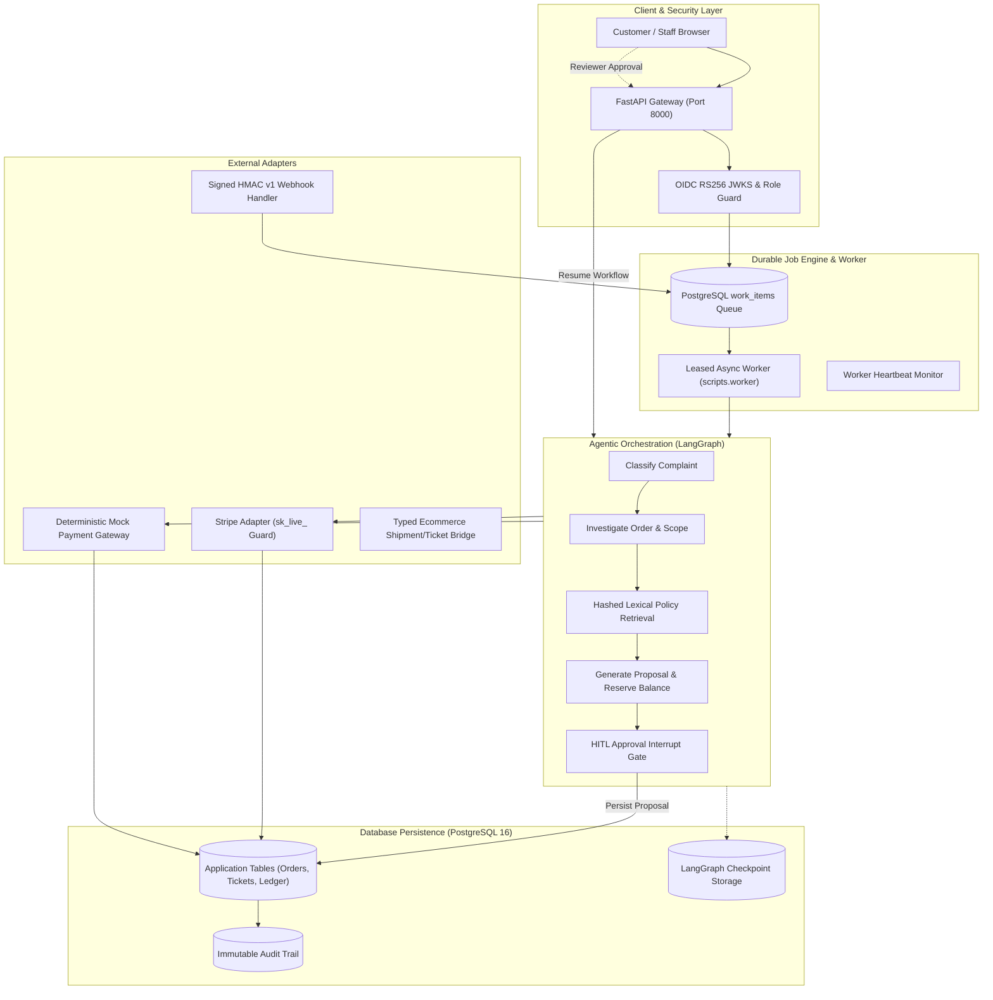
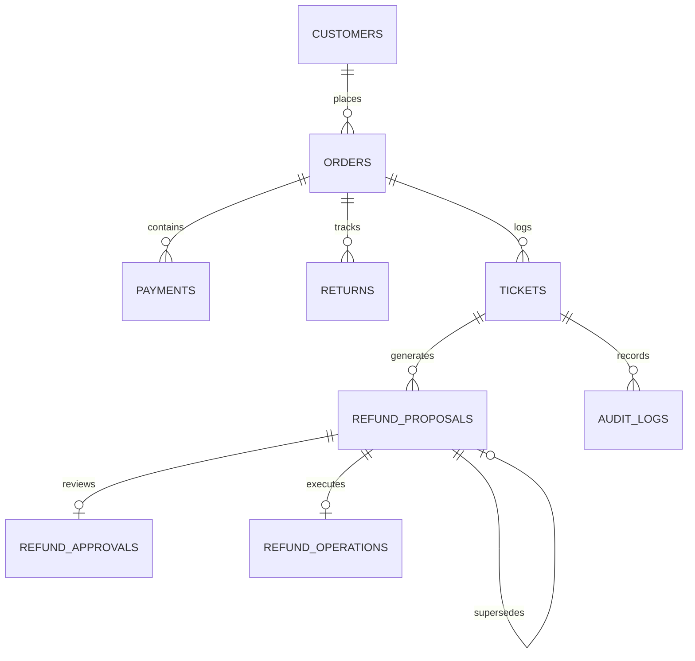
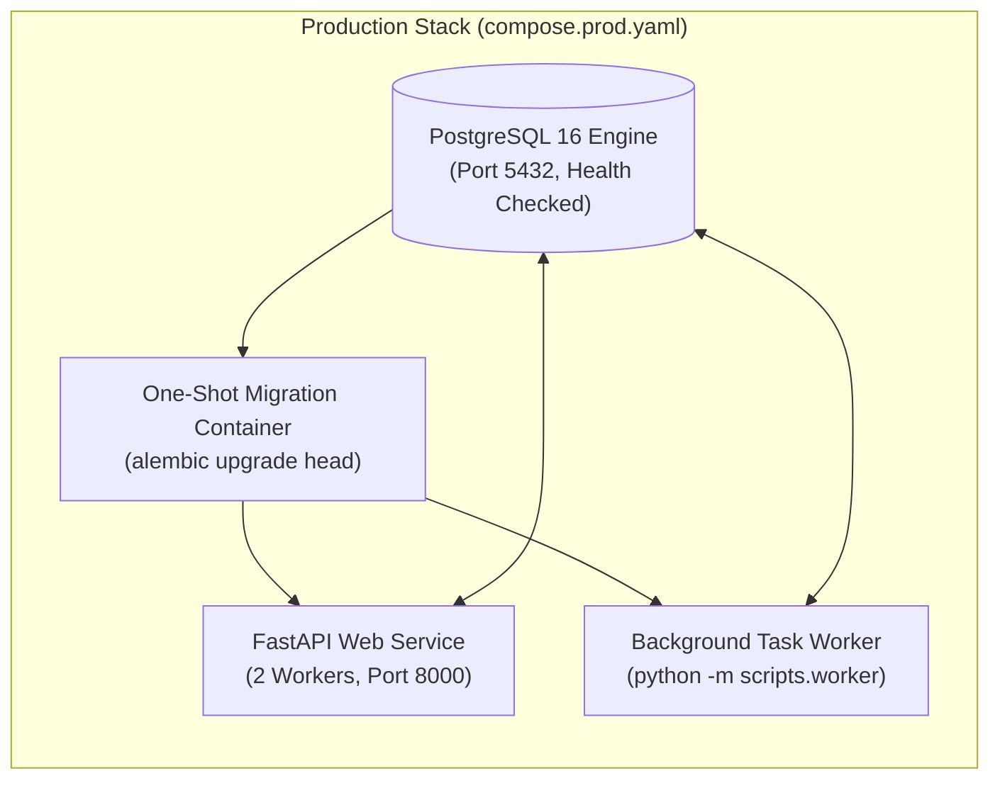

# System Architecture & Technical Design

[](docs/ARCHITECTURE.md)
[](migrations/versions/0003_proposal_supersession.py)
[](https://github.com/langchain-ai/langgraph)

This document details the architectural principles, component responsibilities, state machine semantics, storage structures, and production topologies of the Customer Support Resolution Agent.

---

## 📑 Table of Contents
- [Design Philosophy & Core Invariants](#design-philosophy--core-invariants)
- [System Architecture Overview](#system-architecture-overview)
- [End-to-End Resolution Lifecycle](#end-to-end-resolution-lifecycle)
- [LangGraph Orchestration & State Machine](#langgraph-orchestration--state-machine)
- [Storage & Relational Schema](#storage--relational-schema)
- [Durable Queue & Concurrency Model](#durable-queue--concurrency-model)
- [Production Deployment Topology](#production-deployment-topology)
- [REST API Surface](#rest-api-surface)

---

## 💡 Design Philosophy & Core Invariants

Autonomous agents interacting with financial infrastructure require strict deterministic boundaries:

1. **Separation of Reasoning and Financial Authority:** The LangGraph agent reasons over customer messages, pulls order history, and retrieves policies to construct a resolution proposal. The workflow **never** directly executes a refund; execution is gated by a stored human reviewer approval.
2. **Atomic Balance Reservation:** When a refund proposal is created, money is reserved at the database row level via conditional updates (`available_balance >= proposal_amount`). No other thread or proposal can double-commit funds.
3. **Idempotency Pinned to Durable Proposals:** Every refund execution pins a single provider idempotency key to the exact proposal. Retries, replays, or network recovery cycles always reuse this unique key.
4. **Reconciliation-First Network Recovery:** If a payment provider call times out or returns an ambiguous status, the system enters `PENDING_RECONCILIATION`. Terminal status is established by querying the provider's ledger before any local ticket or order status is updated.

---

## 🏗️ System Architecture Overview



---

## 🔄 End-to-End Resolution Lifecycle

1. **Ingress & Authentication:**
   The customer submits a complaint via `POST /api/complaints`. The system validates user authentication (Bearer token or OIDC JWT) and assigns tenant scoping.
2. **Order Ownership Validation:**
   The system independently verifies that the requested order ID belongs to the authenticated customer subject before passing data into workflow tools.
3. **Deterministic Investigation & Policy Retrieval:**
   - Evaluates order shipping state, return tracking, and warehouse inspection status.
   - Computes 128-dimensional hashed lexical projections against versioned policies (e.g., standard returns, damaged goods, non-returnable items).
   - Rejects low-confidence matches via configurable lexical abstention.
4. **Proposal Creation & Balance Reservation:**
   If policy criteria are met, the system creates a `RefundProposal` and reserves minor-unit funds atomically in the payment record. If policy checks fail or evidence is missing (e.g. damaged goods > $100 without photos), the ticket is routed directly to a human specialist.
5. **Human-in-the-Loop Review Gate:**
   The workflow triggers an `interrupt()`, serializing graph state to the checkpointer and moving the proposal to the reviewer queue (`GET /api/approvals/pending`).
6. **Execution or Invalidation:**
   - **Approval:** Authenticated reviewer issues `POST /api/approvals/{id}/decision` (`APPROVED`). The workflow resumes, executing the payment adapter with the proposal's durable idempotency key.
   - **Rejection:** Moving the proposal to `DECLINED` releases the reserved balance and responds to the customer explaining the decision.
7. **Settlement & Audit:**
   The gateway response is confirmed, local order balance is debited, the support ticket is updated to `RESOLVED`, and linked events are written to the audit trail.

---

## 🧠 LangGraph Orchestration & State Machine

The orchestration graph is defined in `app/workflows/graph.py` with native persistence:

```
[START]
   │
   ▼
[classify_complaint]
   │
   ▼
[investigate_order]
   │
   ▼
[retrieve_policy]
   │
   ▼
[generate_proposal] ── (Policy Failed / Specialist Required) ──► [escalate_ticket] ──► [END]
   │
   ▼ (Valid Refund Proposed)
[INTERRUPT: Human Review Gate]
   │
   ├── (Rejected) ──► [release_reservation] ──► [respond_to_customer] ──► [END]
   │
   └── (Approved) ──► [execute_refund]
                           │
                           ├── (Success) ──► [update_ticket] ──► [audit_trail] ──► [END]
                           │
                           └── (Timeout) ──► [reconcile_timeout] ──► [update_ticket] ──► [END]
```

### Checkpointing Semantics
- Graph state is persisted using official LangGraph checkpointers (`AsyncSqliteSaver` or `AsyncPostgresSaver`).
- Application state (financial proposals, payment balances) is kept distinct from graph step state to maintain database normalization and referential integrity.
- Resuming an interrupted graph requires `Command(resume=...)` on the original thread ID; the API reloads the reviewer approval directly from the database to prevent client parameter tampering.

---

## 🗄️ Storage & Relational Schema

Managed through **Alembic** with forward-only migrations:
- `0001_initial`: Base schema (customers, orders, returns, payments, tickets, proposals, approvals, audit logs, policies).
- `0002_reliability`: Adds `work_items` durable queue, rate limit buckets, request receipts, and provider events.
- `0003_proposal_supersession`: Adds `refund_proposals.supersedes_proposal_id`, self-referential foreign key, index, and table-level status check constraints.



### Financial Precision
- All monetary balances (`total_amount`, `available_balance`, `proposal_amount`) are represented as integer minor units (cents) paired with ISO currency codes (e.g. `USD`).
- Database constraints enforce `available_balance >= 0` and prevent overcommitment.

---

## ⚙️ Durable Queue & Concurrency Model

When asynchronous execution is enabled (`ASYNC_WORKFLOWS=true`):
- Complaints and approvals enqueue tasks into `work_items`.
- Workers claim ready jobs using PostgreSQL row locking:
  ```sql
  SELECT * FROM work_items 
  WHERE status = 'READY' AND run_at <= NOW() 
  ORDER BY priority DESC, id ASC 
  FOR UPDATE SKIP LOCKED 
  LIMIT 1;
  ```
- Claims hold an active lease timeout. If a worker terminates abruptly, the unrenewed lease expires, allowing healthy workers to safely claim and recover the job.
- Dead jobs are isolated after 8 exponential backoff retries.

---

## 🚢 Production Deployment Topology

Defined in `compose.prod.yaml` for high availability and process isolation:



1. **Database:** Dedicated PostgreSQL 16 Alpine container with persistent named volume and health checks.
2. **Migration Job:** Standalone container runs `alembic upgrade head` and exits `0` before application services initialize.
3. **API Service:** Multi-worker Uvicorn process serving REST endpoints and the UI portal.
4. **Worker Service:** Background daemon executing queue tasks, lease renewals, and timeout reconciliations.

---

## 🌐 REST API Surface

| Method & Route | Description | Authorization | Idempotent |
| :--- | :--- | :--- | :---: |
| `GET /` | Application Web Portal | Public | Yes |
| `GET /api/health` | Service liveness probe | Public | Yes |
| `GET /api/ready` | Database & worker heartbeat probe | Public | Yes |
| `GET /api/metrics` | Operational queue and refund metrics | Reviewer / Staff | Yes |
| `GET /api/session/me` | Current authenticated profile & roles | Authenticated | Yes |
| `POST /api/complaints` | Ingest complaint and begin workflow | Customer / Reviewer | Header `Idempotency-Key` |
| `GET /api/tickets` | List user-scoped tickets | Authenticated | Yes |
| `GET /api/tickets/{id}` | Ticket details and investigation evidence | Owner / Reviewer | Yes |
| `GET /api/tickets/{id}/audit-trail` | Chronological immutable audit history | Owner / Reviewer | Yes |
| `GET /api/approvals/pending` | Reviewer approval queue | Reviewer / Staff | Yes |
| `POST /api/approvals/{id}/decision` | Record decision and resume workflow | Reviewer / Staff | Yes |
| `GET /api/workflows/{id}` | Inspect LangGraph workflow state snapshot | Owner / Reviewer | Yes |
| `POST /api/integrations/stripe/webhook` | Ingest signed Stripe events | HMAC `Stripe-Signature` | Header `Stripe-Event-Id` |

*Executable interactive OpenAPI documentation is accessible at `/docs`.*
