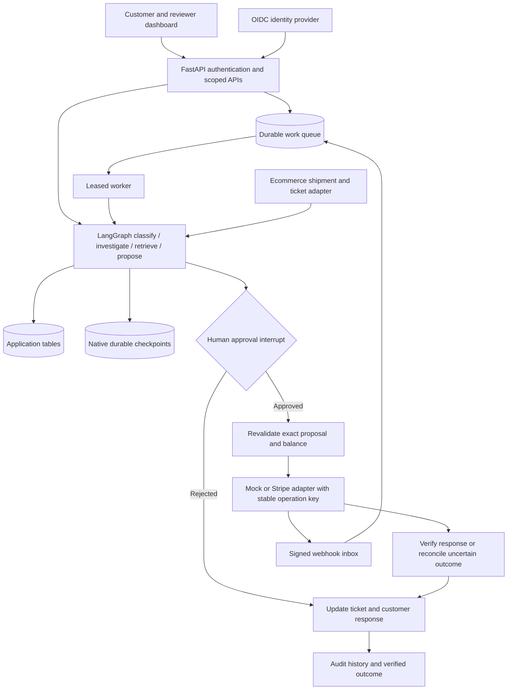

# Architecture

## Request and resolution flow

The same-origin dashboard sends a complaint with a bearer identity to FastAPI. The API derives customer identity from authentication and checks explicit order ownership. Investigation also checks ownership for order IDs extracted from message text.

LangGraph runs classification → investigation → policy retrieval → proposal. The proposal routes to direct response, specialist escalation or a pending human approval. Pending runs exit without executing payments. The application stores the resulting workflow state as JSON in `workflow_runs`.

A reviewer decision is stored against the immutable proposal. The API locates its workflow and resumes from the approval stage using the database decision. It never trusts a supplied resume payload as authorization. The approved branch executes the refund, reconciles timeout results and updates the ticket; the rejected branch records rejection and releases the financial reservation.

Native LangGraph checkpointers persist each graph step using the official SQLite or PostgreSQL saver. Application snapshots and checkpoint tables are logically separate. Human review uses `interrupt()` and resumes with `Command(resume=...)` on the original thread ID. The engine reloads the stored reviewer decision before resuming and never treats the request's decision fields as approval.

The workflow stores its initial run before executing. For an interrupted approved run, the reviewer-only resume route retries the pending graph step; the refund service reuses its existing operation and provider key. If payment succeeded but ticket update failed, replay consults the successful operation and retries the ticket step.

Development may execute short workflows synchronously. With `ASYNC_WORKFLOWS=true`, complaint submission atomically creates the ticket, run snapshot, request receipt and `start` job, returning `202 Accepted`. Reviewer decisions enqueue `resume` jobs. Workers claim jobs with database row locking, set leases, retry failures with bounded backoff, move exhausted jobs to `DEAD`, publish a heartbeat and scan persisted approvals for crash recovery. The supplied Compose files do not yet run this complete production topology; see `AGENT_HANDOFF.md`.

## Storage

Application migrations are managed by Alembic. LangGraph manages its own checkpoint migrations, initialized before request transactions. SQLAlchemy models store customers, orders, returns, payment balances, tickets, proposals, approvals, refund operations, policy versions/chunks and audit events. Additional tables persist workflow snapshots, request receipts, jobs, leases, rate buckets, provider events and mock gateway transactions. Money uses integer minor units and currency codes.

Proposal creation uses a conditional SQL update to reserve balance atomically. Approval decisions cannot be changed after review. Refund execution uses a database execution lease, locks payment/operation rows where supported, and finds an existing operation by proposal before considering a supplied key. A process-local lock remains an additional guard. The provider adapter stores and checks its original request payload. Reconciliation short-circuits terminal operations, preventing repeated ledger updates.

Migration head currently has known drift: the ORM's proposal-supersession column/index/foreign key are not represented in `0002_reliability`. A new migration must fix this; do not modify already-applied history.

The mock provider stores transactions in a separate table in the same SQLite database for reproducible restart tests. A real provider integration must query the actual provider and cannot treat this table as proof of an external financial outcome.

## Policy retrieval and business rules

Five versioned Markdown policies are split into section chunks. Each includes a document ID, version, effective dates, immutable content hash and stable section citation. Retrieval selects the business-date version, ranks hashed local text vectors and lexical overlap, rejects low-overlap results and fails closed on conflicting chunk identities. This is a transparent local retrieval baseline, not pretrained semantic embeddings.

Business eligibility remains deterministic: warehouse inspection and balance checks gate return refunds; high-value damage, missing evidence, failed inspection and exception conditions route to a specialist. Retrieved text cannot approve or execute a refund. There is no arbitrary code or shell tool exposed to the workflow.

## API

| Route | Purpose | Authorization |
| --- | --- | --- |
| `GET /` | Dashboard | Public local demo shell |
| `GET /api/health` | Service status | Public |
| `GET /api/ready` | Database and worker readiness | Public probe |
| `GET /api/demo/scenarios` | Synthetic examples | Public |
| `GET /api/session/config` | Portal authentication configuration | Public |
| `GET /api/session/me` | Current identity and role | Authenticated |
| `GET /api/metrics` | Queue/refund/escalation counters | Reviewer |
| `POST /api/complaints` | Start resolution | Customer or reviewer |
| `GET /api/tickets` | List scoped tickets | Authenticated |
| `GET /api/tickets/{id}` | Ticket details | Owner or reviewer |
| `GET /api/tickets/{id}/audit-trail` | Linked audit events | Owner or reviewer |
| `POST /api/tickets/{id}/evidence` | Add unverified case evidence | Owner or reviewer |
| `POST /api/tickets/{id}/claim` | Assign escalation to reviewer | Reviewer |
| `GET /api/approvals/pending` | Review queue | Reviewer |
| `POST /api/approvals/{id}/decision` | Record decision and resume | Reviewer |
| `GET /api/workflows` | Paginated scoped run list | Authenticated |
| `GET /api/workflows/{id}` | Persisted workflow | Owner or reviewer |
| `GET /api/workflows/{id}/events` | Redacted run timeline | Owner or reviewer |
| `POST /api/workflows/{id}/messages` | Continue clarification | Owner or reviewer |
| `POST /api/workflows/{id}/resume` | Retry with recorded decision | Reviewer |
| `POST /api/integrations/stripe/webhook` | Signed provider event inbox | Stripe signature |

OpenAPI at `/docs` is the executable request/response reference.
