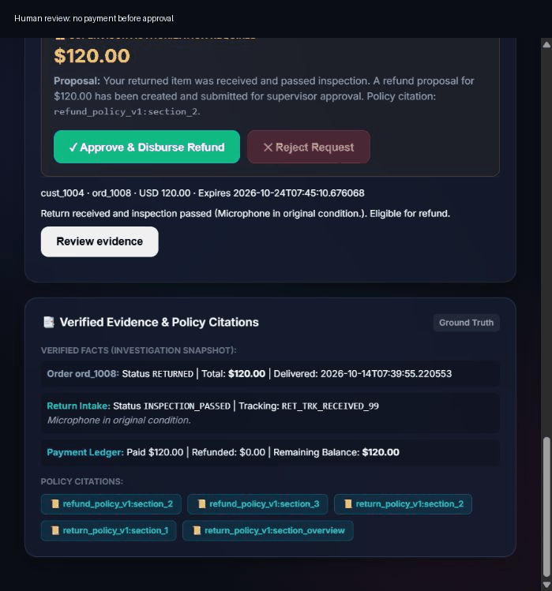
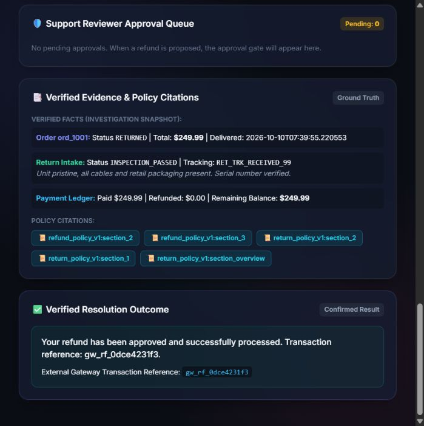
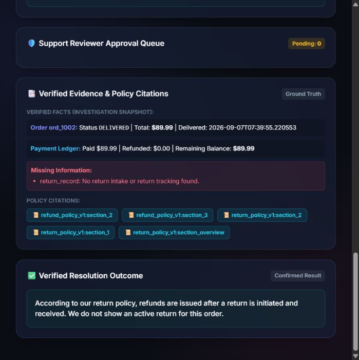
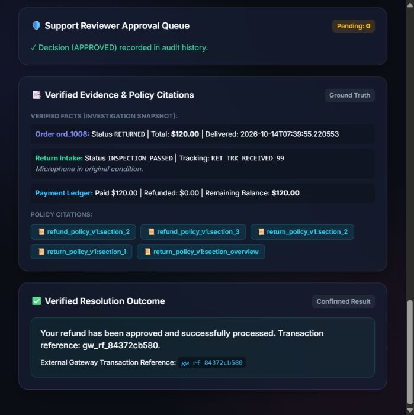
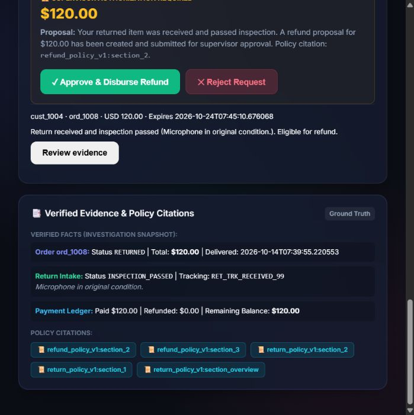

# Interactive Demo & Scenario Walkthrough

[](docs/DEMO.md)
[](http://127.0.0.1:8000)

This document provides visual evidence and step-by-step instructions for reproducing the four core interactive demonstration scenarios included in the Customer Support Resolution Agent web portal.

---

## 📽️ Animated Walkthrough Overview



*The sequence above displays live browser interaction: submitting complaints, policy citation display, approval interrupt, reviewer execution, and verified settlement.*

---

## 📑 Table of Contents
- [How to Launch the Demo](#how-to-launch-the-demo)
- [Scenario A: Standard Approved Refund](#scenario-a-standard-approved-refund)
- [Scenario B: Policy-Blocked Return Request](#scenario-b-policy-blocked-return-request)
- [Scenario C: Gateway Timeout & Reconciliation](#scenario-c-gateway-timeout--reconciliation)
- [Scenario D: High-Value Damaged Goods & Specialist Escalation](#scenario-d-high-value-damaged-goods--specialist-escalation)
- [Reviewer Approval Gate Experience](#reviewer-approval-gate-experience)
- [Restart & Checkpoint Survival Drill](#restart--checkpoint-survival-drill)

---

## 🚀 How to Launch the Demo

1. Start the application locally:
   ```powershell
   ./scripts/start.ps1
   ```
2. Navigate to [http://127.0.0.1:8000](http://127.0.0.1:8000) in your web browser.
3. Use the **Scenario Selector** dropdown at the top of the dashboard to auto-populate customer personas, order IDs, and test complaints.

---

## 🟢 Scenario A: Standard Approved Refund

**Customer:** `cust_1001` | **Order:** `ord_1001` | **Amount:** `$45.00 USD`

### Execution Flow
1. Customer submits a return complaint for order `ord_1001`.
2. The agent queries warehouse return records, finding that item `item_101` was received and passed inspection.
3. Hashed lexical retrieval matches Section 1 of the Standard Return Policy (30-day window).
4. The system calculates eligible refund amount (`$45.00`), creates a `RefundProposal`, and atomically reserves `$45.00` from the payment balance.
5. LangGraph pauses execution at the **Human-in-the-Loop Interrupt Gate**.
6. Switch to the **Reviewer View**, review the cited policy evidence, and click **Approve Proposal**.
7. The payment gateway confirms settlement (`ref_mock_...`), marks the ticket `RESOLVED`, and records audit logs.



---

## 🔴 Scenario B: Policy-Blocked Return Request

**Customer:** `cust_1002` | **Order:** `ord_1002`

### Execution Flow
1. Customer requests a refund for an order delivered 45 days ago without prior return authorization.
2. The agent evaluates the delivery date against Section 1 of the Return Policy (30-day boundary).
3. The policy check fails. The agent abstains from creating a refund proposal.
4. The system drafts a polite response explaining the 30-day policy limitation with exact citations, closes the ticket, and moves 0 funds.



---

## 🟡 Scenario C: Gateway Timeout & Reconciliation

**Customer:** `cust_1004` | **Order:** `ord_1008`

### Execution Flow
1. Item is eligible for refund; reviewer approves the proposal.
2. The mock payment gateway is configured to simulate an HTTP connection timeout during payment execution.
3. The system captures the timeout, sets the operation status to `REFUND_TIMEOUT_RECONCILIATION_REQUIRED`, and leaves the ticket open.
4. The automated reconciliation loop kicks in, querying the gateway with the **original unique idempotency key**.
5. The gateway confirms that the transaction was recorded; the local operation transitions to `REFUND_RECONCILED_SUCCESS` without creating duplicate payments.



---

## 🟠 Scenario D: High-Value Damaged Goods & Specialist Escalation

**Customer:** `cust_1003` | **Order:** `ord_1005`

### Execution Flow
1. Customer reports a broken high-end monitor valued at `$320.00`.
2. The agent retrieves the Damaged Goods Policy: claims > $100 require photographic evidence or carrier inspection before approval.
3. Because no photo attachments are provided, the system does not create an automated refund proposal.
4. The workflow escalates the case to a human tier-2 support specialist with a flagged priority ticket.

---

## 👔 Reviewer Approval Gate Experience

Reviewers can switch roles via the persona selector or authenticate via OIDC:
- **Pending Queue:** Lists all active proposals with exact dollar amounts, customer identifiers, and expiration timers.
- **Evidence Panel:** Displays verbatim policy citations, order shipment dates, carrier tracking status, and warehouse intake logs.
- **Decision Controls:** Single-click approval or rejection. Rejections release reserved financial balances back to the customer's payment record.



---

## 🔄 Restart & Checkpoint Survival Drill

To verify that state survives server crashes and restarts:

```bash
python -m scripts.verify_restart
```

This automated script:
- Spins up a background instance and enqueues a refund proposal.
- Forcibly kills the server process.
- Starts a new server process on the same database.
- Confirms that the pending approval and LangGraph checkpoints remain 100% intact.
