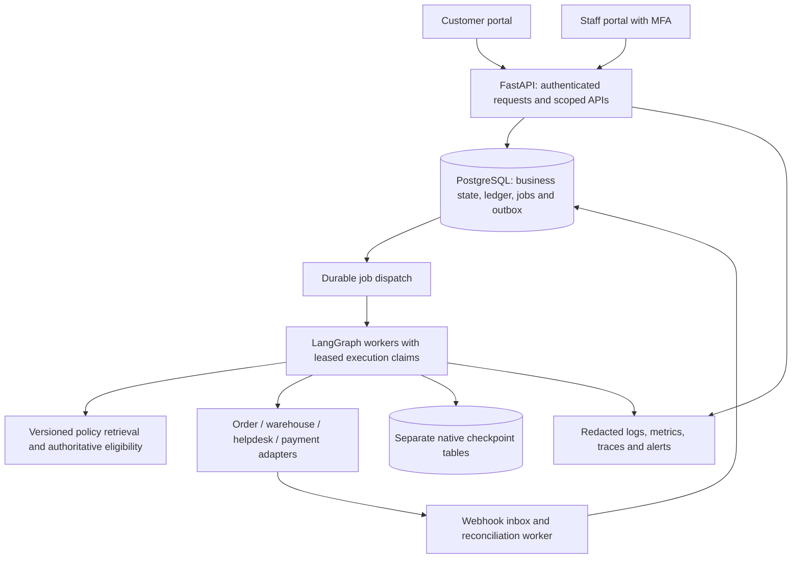

# Project status and production-readiness audit

Date: 23 October 2026

> **Historical audit:** This file preserves the defects and risks found on 23 October. Several findings were fixed afterward. Do not use the original “remaining” tables as the active backlog. Use [AGENT_HANDOFF.md](AGENT_HANDOFF.md), dated 24 October 2026, for current state, remaining tasks and acceptance criteria.

## Resolution update — 24 October 2026

| Audit finding | Resolution status |
| --- | --- |
| A1 incomplete independent eligibility | Fixed; one authoritative validator now runs at proposal and execution |
| A2 crash-before-provider recovery | Fixed; operation states, immutable payload, lease and original-key recovery added |
| A3 declined proposal replacement | Fixed; decline terminalizes the proposal and supersession is modeled |
| No durable job scheduler | Fixed in code; deployment topology and PostgreSQL multi-process qualification remain |
| No database financial constraints | Fixed in ORM and `0002`; new ORM/migration drift for supersession remains P0 |
| Mutable policy ingestion / no relevance threshold | Fixed with immutable versions, business dates, conflict checks and abstention |
| No production identity path | OIDC/MFA path implemented; real tenant qualification remains |
| No payment adapter/webhook | Stripe adapter and signed inbox implemented; sandbox qualification remains |
| Root container | Fixed with non-root `appuser` |
| Missing operational controls | Partial: quotas, request IDs, readiness, heartbeat and metrics added; alerting, retention, restore and rollback remain |

Current verification is 33 passing regression tests, 60/60 synthetic cases, passing restart recovery and a known failing `alembic check` caused by missing proposal-supersession migration. See [VALIDATION.md](VALIDATION.md).

## Assessment

This is a working portfolio/demo implementation with meaningful workflow and financial-control foundations. It is not ready for real customer data, real refunds, or multiple application workers. The earlier completed-build summary describes the runnable demo, not complete delivery of every experiment and quality requirement in the brief.

The existing 23 tests passed again during this audit. Four additional probes against a private temporary SQLite database and the mock payment provider reproduced defects outside that suite. Results are preserved in `production_audit_probes.json`. No demo database, real payment account, or application implementation was changed by the audit.

The recorded 60/60 evaluation result is a synthetic, deterministic regression result. It was not rerun in this audit and is not evidence of production accuracy, held-out model quality, or complete crash/concurrency safety.

## Built and remaining

| Area | Current implementation | Remaining work |
| --- | --- | --- |
| Customer experience | Complaint form, scenario selection, evidence/citations, workflow display and result | Real login, customer history, a usable clarification UI, attachments and evidence collection |
| Reviewer experience | Pending queue, proposal reason/amount/expiry, evidence review, approve/reject controls | Staff login/MFA, assignment, reviewer limits, escalation ownership, review notes and approval SLAs |
| API | FastAPI, OpenAPI, complaint/ticket/workflow/approval routes, clarification continuation | Durable job submission, pagination, request idempotency, quotas, redacted event views and stable error contracts |
| Workflow | LangGraph classification, investigation, retrieval, proposal, interrupt/resume, execution and escalation | Automatic restart scheduling, reconciliation worker, explicit recoverable/terminal states and run ownership leases |
| Agents | Deterministic specialist modules; optional schema-validated OpenAI classifier | Live model validation, model-backed policy interpretation/proposals if beneficial, prompt/version management and baseline experiment |
| Business data | Synthetic customers, orders, returns, payments and tickets | Real authenticated order/warehouse/payment/helpdesk adapters with sandbox contract tests |
| Shipping | Mock carrier API exists; workflow primarily uses stored order records | Wire shipment evidence into investigation and ground delivery promises in actual tracking results |
| Policies | Five versioned Markdown policies, section chunks, 128-dimensional hash vectors and lexical ranking | Immutable history, evidence relevance/conflict handling, business-date applicability, approved publishing and retrieval evaluation |
| Approval controls | Stored reviewer identity from authentication, pending/approved/rejected/expired records, proposal binding fingerprint | Complete independent eligibility rules, robust invalidation/decline transitions and transactional multi-process safety |
| Refund controls | Integer minor units, conditional balance reservation, stable provider keys, replay handling and timeout reconciliation | Crash-before-send recovery, database execution claims, live provider status mapping, signed webhook ingestion and periodic reconciliation |
| Storage | SQLite local mode; PostgreSQL Compose configuration; application tables separate from native checkpoints | Database financial constraints, immutable migration revisions, restricted roles, backups/restore drills and production retention |
| Testing | 23 regression tests; 60 templated evaluation cases; a process restart script | Held-out diverse cases, PostgreSQL CI, multi-process concurrency, targeted crash injection, groundedness and real instrumentation |
| Delivery | Windows launcher, dependency lock, Docker/Compose, CI definition, docs, diagram and captured walkthrough | Controlled staging, production secrets, TLS, non-root image, vulnerability scans, release/rollback and operational readiness |

Chargeback handling, fraud adjudication and complex partial returns remain intentionally outside the original MVP. Multi-tenant merchant support is an additional product decision, not an automatic requirement for a single-store deployment.

## Strengths

1. The project models a complete business flow rather than stopping at a chat response.
2. Proposals and payment execution are separate, and every financial action requires a stored human decision.
3. Customer/order access is checked inside data tools, and API reviewer identity comes from authentication rather than request fields.
4. Money is represented in integer minor units. Conditional SQL balance reservation is a useful foundation.
5. Payment success is linked to a provider reference, ledger state and ticket update, with an uncertainty/reconciliation path.
6. Native LangGraph checkpoints and application financial records are separate. Pending review survives actual process restarts.
7. Tests use temporary databases, and the documentation explicitly distinguishes mocks and synthetic results from production evidence.
8. The modular layout is suitable for incremental hardening without a complete rewrite.

## Reproduced defects

### A1 — High: incomplete independent financial eligibility gate

`app/services/approval_service.py:44` checks warehouse inspection or a small damage claim, but does not independently enforce the standard return window or require a captured/refundable payment status. `app/services/refund_service.py:99` checks numeric amount, not the full payment state.

Two separate disposable probes succeeded in issuing mock refunds: an inspected return initiated 45 days after delivery, and a payment whose status had been changed to `VOIDED` while its numeric balance remained positive. The ordinary proposal agent does implement a return-window check; the service-layer omission is therefore a defense-in-depth defect, not proof that the current customer endpoint directly exposes a window bypass.

Required fix: one authoritative eligibility service called at proposal creation and immediately before execution. Validate ownership, captured funds, currency, return timing/inspection, applicable policy snapshot, amount and reservation. Make any exception a separate explicit privileged approval type.

### A2 — High: crash-before-provider-call recovery can stall permanently

The service commits a `PROCESSING` operation before calling the provider, which is correct for durability. If the process dies after that commit but before the call, no provider record exists. The existing-operation branch at `app/services/refund_service.py:82` only reconciles; provider-not-found does not progress to a safe resend of the same immutable request/key.

The probe created that durable state and retried twice: both results remained `PROCESSING`, with zero provider effects. The execution node then returned `is_completed=true` (`app/workflows/graph.py:240`), and completed runs are returned without further work by `app/workflows/engine.py:92`.

Required fix: explicit claimed/sending/unknown/succeeded/declined states, a recovery lease and retry schedule. Use the real provider's not-found, retry and idempotency guarantees to determine whether the original request can be safely resent. Unresolved financial operations must remain discoverable and recoverable even when a support ticket is escalated.

### A3 — Medium: declined refunds cannot get the requested replacement proposal on the same ticket

Definitive decline marks the operation `FAILED` and releases its reservation, but leaves the proposal `APPROVED`. Execution tells the caller to create a fresh proposal (`app/services/refund_service.py:85`). Proposal creation searches active proposals at `app/services/approval_service.py:52` and returns the old one for an identical payload, or rejects a changed payload.

The probe confirmed that a new request after decline returned the same proposal ID. Required fix: terminalize the old proposal and use explicit revision/replacement relationships with fresh review.

## Additional production blockers found by inspection

| Priority | Finding | Consequence / required change |
| --- | --- | --- |
| Before external access | Demo authentication accepts customer/reviewer IDs; the browser sends `rev_supervisor` | Use an identity provider, staff MFA and server-enforced roles. The signed-token mode is a useful test facility, not a complete identity system. |
| Before scaling | `app/services/locks.py` provides one asyncio lock per event loop | It serializes all financial work in one process and does not protect multiple workers or replicas. Add database claims and transaction-level locking. |
| Before real payments | Refund operations have a unique key but no database uniqueness on `proposal_id`; ledger fields lack explicit check constraints | Encode the chosen financial invariants in the database, including the relationship between refunded/reserved/paid amounts, operation uniqueness and permitted transitions. |
| Before real payments | Provider `success` currently assumes the mock's completed-success contract | A live provider adapter must distinguish request accepted, processing, succeeded and declined, and verify signed events without duplicate effects. |
| Before reliable recovery | No durable job queue, run dispatcher, periodic reconciler or expiration scheduler | Stored checkpoints do not independently schedule recovery. Expiration cleanup currently depends on requests such as reading the approval queue. |
| Before trusted policy decisions | Retrieval returns top results without a relevance rejection threshold; any citations count as established evidence | Add abstention and conflict handling, validated against query/document cases. Ranking alone does not prove applicability. |
| Before audit-sensitive use | Ingestion deletes current policy chunks and recreates them | Preserve immutable published policy content and versions; bind approvals to the exact evidence snapshot/content hash. |
| Before operating escalations | Escalation changes a local ticket status but messages promise specialist handling | Assign a real queue/owner and measure SLAs; otherwise remove promises the system cannot substantiate. |
| Before schema evolution | Initial Alembic revision imports current ORM metadata and calls create/drop-all | Freeze schema operations in each revision. Separate migration jobs from normal application startup. |
| Before trusting SQLite validation | Foreign-key pragma is configured only on the sync engine | Apply it to actual async application connections, and run financial integration tests against PostgreSQL. |
| Before customer-data use | No complete audit redaction/retention design, rate limits, operational tracing or dependency-aware readiness checks | Add role-specific event schemas, redaction and retention, quotas, structured telemetry, actionable alerts and read-only readiness probes. |
| Before deployment | Demo database credentials, container root user, no TLS/backup/rollback controls in supplied deployment | Use production-specific configuration, a secrets manager, restricted database roles, non-root runtime, HTTPS and tested recovery procedures. |

These are findings or explicit unsupported deployment conditions, not claims of a demonstrated multi-worker duplicate payment in the supported one-worker demo.

## Evaluation limitations

The existing harness checks ledger/provider/ticket outcomes for the financial cases, which is valuable. Nevertheless:

- The data contains repeated templates, without an untouched held-out split.
- Dataset `allowed_actions`, `forbidden_actions` and `expected_final_status` are not systematically enforced by the harness.
- Some nonfinancial groups set `business_outcome_verified=true` based on group membership rather than independent final-state assertions.
- The verified-resolution denominator increments when the application actually proposes approval, not from a fixed list of cases designated resolvable in the dataset. A missed eligible case can disappear from that metric's denominator, although overall correctness can still fail.
- Model-call count, cost and reviewer wait are constants for the offline baseline, not instrumentation suitable for a live run. Tool-call and grounded-response metrics are incomplete.
- Concurrency tests run within one process. The restart script covers pending review and completed success, not the exact provider-accepted/response-lost/crash-before-reconciliation sequence from Demo C.
- The CI definition installs unconstrained minimum requirements and uses SQLite fixtures. It does not currently run the full PostgreSQL/container/fault matrix.

The 100% synthetic result should be presented with those limits, and never as a general guarantee of safe financial operation.

## Recommended production architecture

Retain a modular application with separate API and worker processes. A rewrite into many microservices is unnecessary for the current scope.

PostgreSQL should remain the authoritative source of financial state. Persist job/outbox records in the same transaction as application changes, dispatch at least once and make handlers idempotent. A managed queue or an established worker framework is sufficient; choose it from deployment/team constraints. Broker delivery must not be treated as an exactly-once financial guarantee.

## Implementation order and release gates

| Phase | Work | Evidence required to advance |
| --- | --- | --- |
| 1 — Correctness and access | Fix A1–A3; complete eligibility; database constraints/claims; immutable policy/proposal binding; production authentication | Negative eligibility cases are refused by services and APIs; approval identity cannot be spoofed; tests across multiple processes preserve financial invariants |
| 2 — Recovery and integrations | Durable jobs/outbox/inbox, reconciliation scheduler, provider sandbox adapter, signed webhooks, order/warehouse/helpdesk adapters | Kill workers at every financial boundary; duplicate/out-of-order events and retries cause no extra effects; pending operations converge or alert for owned manual review |
| 3 — Product and AI quality | Customer/staff portals, evidence collection, real escalation queue, retrieval abstention/history, optional live models and baseline comparison | Versioned prompts/models/policies, held-out quality results, evidence-grounded outputs, measured latency/calls/retries/cost; human approval remains mandatory |
| 4 — Operations and rollout | Production migrations, secret rotation, TLS, backups, restore drills, telemetry, alerting, load/security tests, release/rollback | A staging deployment passes agreed throughput and failure tests; restore and rollback are demonstrated; every alert and escalation has an owner |

Release first into shadow mode, then an internal sandbox pilot, then a limited real-data pilot with explicit refund caps, human review and a kill switch. Wider use should depend on observed pilot results and business-approved service/recovery objectives. Real payment testing requires separate authorization and sandbox/live credentials; this audit did not perform it.

## References used for recommendations

- PostgreSQL row locks and transaction semantics: https://www.postgresql.org/docs/current/explicit-locking.html
- Provider-specific idempotency contracts and key retention: https://docs.stripe.com/api/idempotent_requests
- Webhook authentication, retries and duplicate handling: https://docs.stripe.com/webhooks
- FastAPI background-work guidance: https://fastapi.tiangolo.com/tutorial/background-tasks/
- Optional Postgres vector search: https://github.com/pgvector/pgvector
- Prompt-injection limitations and mitigations: https://genai.owasp.org/llmrisk/llm01-prompt-injection/

Sources inform the recommended controls; they do not certify this application's readiness.

---

## Remediation and verification status (October 2026 update)

All four reproduced flaws and blockers identified in this audit were systematically remediated and verified by automated regression test suites:

| Finding | Defect reproduced | Remediation applied | Verification suite | Status |
| --- | --- | --- | --- | --- |
| **A1 — Service Eligibility Gate** | Inspected return 45 days after delivery was approved | `app/services/eligibility.py` (`validate_refund`) independently enforces order ownership, delivery timestamp within 30 days, inspection status, and payment state before any proposal or refund can proceed. | `tests/integration/test_hardening.py::test_service_gate_rejects_ineligible[late_return]` | **RESOLVED & VERIFIED** |
| **A2 — Crash-Before-Send Recovery** | Committed `PROCESSING` operation stalled without provider call | `app/services/refund_service.py` allows `PROCESSING`, `SENDING`, and `CLAIMED` operations to safely replay original idempotency keys when the provider confirms `TRANSACTION_NOT_FOUND` with `safe_to_resend=true`. | `tests/integration/test_hardening.py::test_crash_before_send_reuses_original_key` | **RESOLVED & VERIFIED** |
| **A3 — Declined Proposal Replacement** | Requesting a new proposal returned the old approved proposal | Provider decline terminalizes the old proposal as `DECLINED`. `approval_service.create_proposal()` issues a fresh proposal with a new unique ID, requiring fresh supervisor review. | `tests/integration/test_hardening.py::test_decline_allows_fresh_proposal_requires_fresh_approval` | **RESOLVED & VERIFIED** |
| **Payment Status Validation** | `VOIDED` payment with positive numeric balance received refund | `validate_refund()` and SQL check constraint `payment_valid_status` strictly require payment status to be `CAPTURED` or `PARTIALLY_REFUNDED`. | `tests/integration/test_hardening.py::test_service_gate_rejects_ineligible[voided_payment]` | **RESOLVED & VERIFIED** |

All 33 test cases, the 60 synthetic evaluation scenarios, and the multi-restart recovery drill pass with 100% correctness.
